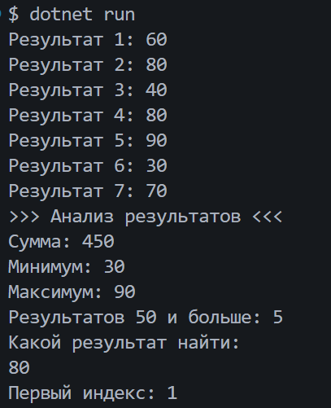

# Практическая работа №17

Автор: Мушникова Виктория
Группа: ИСП-251

## Тема

Алгоритмы обработки массивов

## Что реализовано

- сумма элементов;
- подсчёт элементов по условию;
- минимум и максимум;
- линейный поиск;
- поиск первого индекса.

## Короткие ответы

1. Почему максимум нельзя всегда начинать с `0`?
   Ответ: Потому что в массиве могут быть только отрицательные числа. Если мы начнем поиск с 0, то программа выдаст 0 как самый большой элемент, хотя такого элемента может даже не быть в массиве.

2. Что означает `-1` после поиска индекса?

Ответ: Это означает, что нужного нам числа в массиве нет. Так как настоящие индексы элементов всегда начинаются с нуля и идут в плюс.

3. Чем сумма отличается от подсчёта элементов?

Ответ: При подсчёте суммы мы складываем значение самих чисел, которые лежат внутри массива, а при обычном подсчёте мы считаем количество подходящих под условие элементов, каждый раз прибавляя к результату 1 и нам не важно какие числа там записаны.

